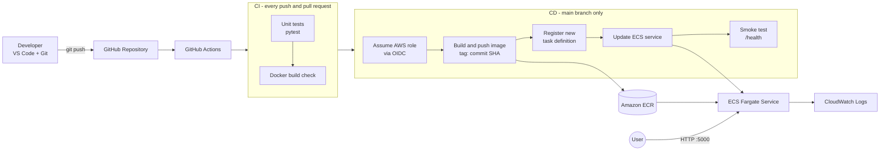
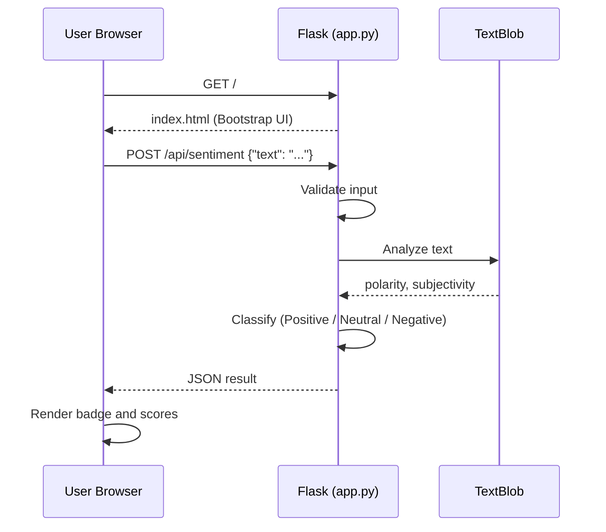

# Sentiment Analyzer: Flask App with CI/CD on AWS ECS Fargate (GitHub Actions + OIDC + Terraform)

A Python Flask web application that analyzes the sentiment of customer feedback using **TextBlob**. Users type a review or comment into a web page and instantly get a sentiment label (Positive / Negative / Neutral) with polarity and subjectivity scores.

The app is containerized with Docker and stored in **Amazon ECR**. It runs on **Amazon ECS Fargate**, and every push to `main` is tested, built, and deployed automatically by **GitHub Actions**. GitHub authenticates to AWS with short-lived **OIDC** credentials (no stored access keys), and the whole AWS environment is provisioned with **Terraform**.

The project started as a manual deployment on ECS with the EC2 launch type, then evolved into a fully automated pipeline. The original manual guide and the real errors encountered along the way are kept in this README, because they show how the project developed.

---

## Table of Contents

1. [Features](#features)
2. [Architecture](#architecture)
3. [Tech Stack](#tech-stack)
4. [Project Structure](#project-structure)
5. [Prerequisites](#prerequisites)
6. [Run Locally](#run-locally)
7. [API Reference](#api-reference)
8. [Deployment Guide (Terraform + GitHub Actions)](#deployment-guide-terraform--github-actions)
9. [Updating the App](#updating-the-app)
10. [Troubleshooting: Errors and Solutions](#troubleshooting-errors-and-solutions)
11. [Cost Notes](#cost-notes)
12. [Cleanup](#cleanup)
13. [Appendix: Original Manual Deployment (EC2 Launch Type)](#appendix-original-manual-deployment-ec2-launch-type)
14. [Future Improvements](#future-improvements)
15. [Lessons Learned](#lessons-learned)

---

## Features

**Application**

- Web UI (Bootstrap 5) for entering text and viewing results
- REST API endpoint for sentiment analysis (`POST /api/sentiment`)
- Sentiment classification with polarity (-1 to 1) and subjectivity (0 to 1) scores
- Input validation and JSON error responses
- Health check endpoint (`/health`) that also reports the app version
- Logging to stdout, collected by the ECS `awslogs` log driver into CloudWatch
- Docker image that runs as a **non-root user** with Gunicorn (2 workers, 4 threads)
- App version set through the `APP_VERSION` environment variable (the pipeline sets it to the commit SHA)

**CI/CD and infrastructure**

- Unit tests (`pytest`) and a Docker build check on every push and pull request
- Automatic build, push, and deploy to ECS on every push to `main`, only after tests pass
- Images tagged with the **commit SHA**, so every deployment is traceable and rollbacks are easy
- **Passwordless AWS access** from GitHub Actions through OIDC, restricted to this repository's `main` branch
- Post-deploy **smoke test**: the pipeline fails if `/health` does not report the commit that was just deployed
- **Automatic rollback** through the ECS deployment circuit breaker
- Entire AWS environment defined as code with Terraform (VPC, security group, ECR, ECS, auto scaling, IAM, logs)

---

## Architecture

### Deployment flow (CI/CD)



<details>
<summary>Original manual deployment diagram (EC2 launch type, before CI/CD)</summary>


</details>

### Application flow



### Components

| Component | Role |
|---|---|
| **GitHub** | Stores source code and version history |
| **GitHub Actions** | Runs tests, builds the image, and deploys on every push to `main` |
| **OIDC identity provider + IAM role** | Lets GitHub Actions assume an AWS role with temporary credentials (no access keys) |
| **Terraform** | Creates and manages all AWS resources as code |
| **Docker** | Packages the app and its dependencies into an image |
| **Amazon ECR** | Private registry that stores the Docker image (scan on push, keeps the last 10 images) |
| **ECS Cluster** | Logical group that manages the tasks |
| **Task Definition** | Blueprint: image URI, CPU/memory, port mappings, log configuration |
| **ECS Service (Fargate)** | Keeps the desired number of tasks running, handles rolling deployments and rollback |
| **VPC, public subnets, Security Group** | Network for the tasks; the security group allows inbound TCP 5000 |
| **IAM Task Execution Role** | Permission for ECS to pull images from ECR and write logs |
| **CloudWatch Logs** | Collects the container's stdout logs (14-day retention) |
| **Application Auto Scaling** | Scales between 1 and 2 tasks based on CPU utilization (target 70%) |

---

## Tech Stack

- **Language / Framework:** Python 3.12, Flask 3.0.3
- **NLP:** TextBlob 0.18.0
- **Web server:** Gunicorn 22.0.0
- **Frontend:** HTML, Bootstrap 5 (CDN), vanilla JavaScript (`fetch`)
- **Containerization:** Docker
- **CI/CD:** GitHub Actions (with OIDC authentication to AWS)
- **Infrastructure as Code:** Terraform
- **Cloud:** AWS ECS (Fargate), ECR, VPC, IAM, CloudWatch, Application Auto Scaling
- **Version control:** Git, GitHub
- **Tools:** VS Code, AWS CLI, Docker Desktop
- **Region:** ap-southeast-5 (Malaysia)

---

## Project Structure

```
my-web-app/
├── app.py                  # Flask application (routes, sentiment logic, logging)
├── templates/
│   └── index.html          # Frontend UI (rendered by Flask)
├── tests/                  # pytest unit tests
├── requirements.txt        # Python dependencies
├── requirements-dev.txt    # Test dependencies (pytest)
├── Dockerfile              # Container build instructions
├── terraform/
│   └── main.tf             # All AWS infrastructure
├── .github/
│   └── workflows/
│       └── deploy.yaml     # CI/CD pipeline
├── .gitignore              # Excludes .venv, __pycache__, .env, terraform/.terraform, *.tfstate
├── .venv/                  # Local virtual environment (not committed)
└── README.md               # This file
```

> **Important:** Flask looks for HTML files in a folder named `templates/`, and the Dockerfile copies that folder into the image (`COPY templates/ templates/`). `index.html` must be inside `templates/`, not next to `app.py`.

> **Important:** `.github/workflows/deploy.yaml` must be in the **repository root**, next to `app.py`, or GitHub will not run it.

### Endpoints

| Route | Method | Description |
|---|---|---|
| `/` | GET | Renders the web UI |
| `/api/sentiment` | POST | Analyzes text and returns sentiment metrics |
| `/health` | GET | Returns `{"status": "healthy", "version": "..."}` with HTTP 200 |

---

## Prerequisites

Install the following on your computer:

| Tool | Purpose | Check installation |
|---|---|---|
| [Git](https://git-scm.com/downloads) | Version control | `git --version` |
| [VS Code](https://code.visualstudio.com/) | Code editor | |
| [Python 3.12+](https://www.python.org/downloads/) | Run and test the app locally | `python --version` |
| [Docker Desktop](https://www.docker.com/products/docker-desktop/) | Build and run container images locally | `docker --version` |
| [AWS CLI v2](https://docs.aws.amazon.com/cli/latest/userguide/getting-started-install.html) | Interact with AWS from the terminal | `aws --version` |
| [Terraform 1.5+](https://developer.hashicorp.com/terraform/install) | Provision the AWS infrastructure | `terraform version` |

Recommended VS Code extensions: **Python**, **Pylance**, **Docker**, **HashiCorp Terraform**, **GitHub Pull Requests**, **Markdown Preview Mermaid Support** (to preview the diagrams in this README).

You also need:

- An **AWS account**
- An **IAM user** with an access key and enough permissions to create the Terraform resources (ECR, ECS, EC2/VPC, IAM, CloudWatch, Application Auto Scaling). This is used **only on your computer** to run Terraform. Run `aws configure` and enter the access key, secret key, region, and output format. GitHub Actions does not use this key; it uses OIDC.
- A **GitHub account** and an empty repository for the code

> Use a least-privilege IAM user rather than the root account for daily work.

---

## Run Locally

### Option 1: Python virtual environment

```bash
python -m venv .venv

# Windows PowerShell
.venv\Scripts\Activate.ps1
# Mac / Linux
source .venv/bin/activate

pip install -r requirements.txt
python app.py
```

Open http://localhost:5000.

> TextBlob's sentiment analysis works out of the box. You only need `python -m textblob.download_corpora` if you later use other TextBlob features such as noun phrase extraction.

### Option 2: Docker

```bash
docker build -t my-web-app .
docker run -p 5000:5000 my-web-app
```

Open http://localhost:5000.

### Run the tests

```bash
pip install -r requirements-dev.txt
python -m pytest -v
```

---

## API Reference

### `POST /api/sentiment`

**Request**

```bash
curl -X POST http://localhost:5000/api/sentiment \
  -H "Content-Type: application/json" \
  -d '{"text": "I absolutely love this product! The service was incredible."}'
```

**Success response (200)**

```json
{
  "status": "success",
  "sentiment": "Positive",
  "badge_color": "success",
  "polarity": 0.6,
  "subjectivity": 0.8
}
```

**Classification rules**

| Polarity | Sentiment |
|---|---|
| greater than 0.1 | Positive |
| less than -0.1 | Negative |
| between -0.1 and 0.1 | Neutral |

**Error responses**

| Status | Cause | Body |
|---|---|---|
| 400 | Missing `text` field | `{"error": "Missing 'text' in request body"}` |
| 400 | Empty or whitespace-only text | `{"error": "Text cannot be empty"}` |
| 500 | Unexpected processing failure | `{"error": "Internal processing error"}` |

### `GET /health`

```bash
curl http://localhost:5000/health
# {"status":"healthy","version":"2.0.0"}
```

When deployed through the pipeline, `version` is the Git commit SHA instead of `2.0.0`.

---

## Deployment Guide (Terraform + GitHub Actions)

### What the pipeline does

The workflow is in `.github/workflows/deploy.yaml`.

1. **Test** (every push and pull request): installs dependencies, runs `pytest`, and verifies the Docker image builds.
2. **Deploy** (push to `main`, only after tests pass):
   - Assumes an AWS IAM role through GitHub OIDC.
   - Builds the image and pushes it to ECR, tagged with the **commit SHA** (and `latest`).
   - Downloads the current task definition, swaps in the new image and sets `APP_VERSION` to the commit SHA, then registers it as a new revision.
   - Updates the ECS service and waits for it to become stable. If the new tasks keep failing, the circuit breaker rolls back automatically.
   - Runs a **smoke test**: finds the task's public IP, calls `/health`, and fails the run if the reported version is not the commit just deployed.
3. A `concurrency` rule prevents two deployments from running at the same time.

### What Terraform creates

- VPC, two public subnets, internet gateway, route table, and a security group (inbound TCP 5000)
- ECR repository (scan on push, lifecycle policy keeps the last 10 images)
- ECS cluster, Fargate task definition (0.25 vCPU, 0.5 GB), and service with circuit breaker and rollback
- Application Auto Scaling (CPU target tracking, 1 to 2 tasks)
- CloudWatch log group (14-day retention)
- Task execution role
- GitHub OIDC identity provider and a least-privilege IAM role that only the `main` branch of this repository can assume

Terraform creates the service and then **ignores later changes to the task definition and task count**, because the pipeline and auto scaling own those.

### Steps

**1. Provision the infrastructure**

```bash
cd terraform
terraform init
terraform apply -var="github_repo=<GITHUB_USER>/<REPO_NAME>"
```

If the GitHub OIDC provider already exists in your AWS account, add `-var="create_github_oidc_provider=false"`. If you created resources manually earlier (cluster, ECR repository, role), delete them first or change the `app_name` variable, otherwise Terraform fails on name conflicts.

**2. Add the GitHub secret**

Copy the `github_actions_role_arn` Terraform output into a repository secret named `AWS_ROLE_ARN` (**Settings > Secrets and variables > Actions**).

**3. Add a `.gitignore` before the first commit**

```
# Terraform
terraform/.terraform/
*.tfstate
*.tfstate.*
*.tfvars
crash.log

# Python
__pycache__/
*.pyc
.venv/
.env
```

> Never commit `terraform/.terraform/` (the AWS provider alone is over 800 MB and GitHub rejects it) or `*.tfstate` (state files can contain sensitive data). Keep `terraform/.terraform.lock.hcl` committed.

**4. Push the code**

```bash
git add .
git commit -m "Add CI/CD pipeline and Terraform"
git push
```

Open the **Actions** tab on GitHub and watch the run. After the first successful run the app is live.

> Until the first push finishes, the ECS service shows failing tasks. This is expected: Terraform creates an empty ECR repository, and the first image is pushed by the pipeline.

**5. Open the app**

The public IP is printed in the workflow run summary. You can also find it at **ECS > Clusters > my-web-app > Services > my-web-app > Tasks > (task) > Networking > Public IP**.

```
http://<public-ip>:5000
http://<public-ip>:5000/health
```

Use `http://` (not `https://`) and include `:5000`.

> **Fargate has no EC2 instances.** AWS runs the container for you, so there is nothing to see under **EC2 > Instances**. The task has its own network interface and public IP.

> **The public IP changes on every deployment.** There is no load balancer, to keep costs low for this personal project. The rolling update starts the new task before stopping the old one, but users must switch to the new IP. An Application Load Balancer is the upgrade for a stable URL and true zero-downtime deployments.

---

## Updating the App

After editing and saving your files:

```bash
git add .
git commit -m "Change n-xxx"
git push
```

That is all. The pipeline tests, builds, pushes, deploys, and verifies the new version. Open the new public IP from the run summary and hard-refresh the browser (Ctrl+F5).

**Notes:**

- Pull requests only run the tests. Deployment happens only on pushes to `main`.
- Changes under `terraform/` or to Markdown files do not trigger a deployment. Infrastructure changes are applied manually with `terraform apply`.
- Each deployment registers a new task definition revision with the commit SHA, so rolling back means redeploying an older commit.
- The old manual process (build, tag, push, `--force-new-deployment`) is no longer needed. It is kept in the [appendix](#appendix-original-manual-deployment-ec2-launch-type).

---

## Troubleshooting: Errors and Solutions

### Part A: Terraform and GitHub Actions

#### A1. `git push` rejected: file exceeds GitHub's 100 MB limit (GH001)

**Symptoms**

```
remote: error: File terraform/.terraform/providers/.../terraform-provider-aws_v6.68.0_x5.exe is 813.34 MB;
this exceeds GitHub's file size limit of 100.00 MB
! [remote rejected] main -> main (pre-receive hook declined)
```

**Cause:** `terraform init` downloads the AWS provider into `terraform/.terraform/`, and `git add .` committed it. Adding a `.gitignore` afterwards does not help because the file is already in the local commit.

**Solution**

1. Create `.gitignore` in the **repository root** with the contents shown in the deployment guide.
2. Undo the local commit but keep your files: `git reset HEAD~1` (check with `git log --oneline` first; if it was the very first commit, use `git update-ref -d HEAD`).
3. Check `git status` (it must no longer list `terraform/.terraform`), then `git add .`, commit, and push again.

---

#### A2. Terraform finished, but there is no EC2 instance and no image in ECR

**Not an error.**

- **No EC2:** Fargate does not use EC2 instances you can see. Look at **ECS > Cluster > Service > Tasks** instead.
- **No image:** Terraform only creates the empty ECR repository. The first image is pushed by the pipeline on the first `git push`.

---

#### A3. Tasks keep failing right after `terraform apply`

**Cause:** The initial task definition points to `<ECR_URI>:latest`, which does not exist until the pipeline pushes the first image.

**Solution:** Push to `main`. The pipeline pushes the image and registers a task definition that points to the commit SHA. The service recovers by itself.

---

#### A4. Cannot find the public IP, or the page does not load

**Solution**

- Read the IP from the workflow run summary, or from **ECS > Service > Tasks > (task) > Networking**.
- Use `http://<ip>:5000` (HTTP, with the port).
- Confirm the task status is **RUNNING** and the security group allows inbound TCP 5000.
- The IP changes after every deployment, so always use the newest one.

---

#### A5. `EntityAlreadyExists` for the OIDC provider, or other name conflicts on `terraform apply`

**Cause:** The GitHub OIDC provider (or a cluster, repository, or role with the same name) was created manually before using Terraform.

**Solution:** Re-run with `-var="create_github_oidc_provider=false"` to reuse the existing provider. For other duplicates, delete the manual resource or set a different `app_name`.

---

#### A6. Workflow fails at "Configure AWS credentials" (`Not authorized to perform sts:AssumeRoleWithWebIdentity`)

**Common causes**

- The `AWS_ROLE_ARN` secret is missing or has a typo.
- The `github_repo` value given to Terraform does not exactly match `<owner>/<repo>` (the trust policy is case-sensitive about the repository).
- The workflow ran on a branch other than `main`. The role trusts only `refs/heads/main`.
- The deploy job lacks `permissions: id-token: write`.

---

#### A7. Smoke test fails with a version mismatch

**Cause:** `/health` reported a different version from the commit that was deployed, which usually means the new task did not start and the circuit breaker rolled back.

**Solution:** Open **ECS > Service > Events** and **Tasks > Stopped** and read the **Stopped reason** to find out why the new task failed (wrong image, out of memory, app crash on start).

---

#### A8. `terraform destroy` does not remove everything

Terraform removes only what it created. Resources made by hand earlier are not in its state. See the leftovers checklist in [Cleanup](#cleanup).

---

### Part B: Application, Git, and Docker

#### B1. Page still shows old content after deployment

**Cause (manual workflow):** The image URI in the task definition did not match the repository the image was pushed to, or the same `:latest` tag was reused so ECS kept running the old task. A task definition revision is fixed once created.

**Solution:** With the pipeline, each deployment registers a new revision pointing to a unique commit-SHA tag, which removes this class of problem. If it still happens, check that the run finished successfully and compare the running task's **Created at** time with your push time.

**How to verify each step**

```bash
cat app.py                                           # is the edit in the file?
docker run --rm my-web-app grep -n "return" app.py   # is the edit in the image?
aws ecr describe-images --repository-name my-web-app --region <REGION> \
  --query "sort_by(imageDetails,&imagePushedAt)[-1].[imagePushedAt,imageTags]"   # was it pushed?
curl http://<public-ip>:5000/health                  # real response without browser cache
```

---

#### B2. `git status` shows "nothing to commit" or GitHub is unchanged

**Common causes and fixes**

- **File not saved:** a white dot on the VS Code tab means unsaved changes. Press Ctrl+S.
- **Editing a copy outside the repo:** check with `pwd` and `git rev-parse --show-toplevel`.
- **Commands chained with `&&`:** if `git commit` fails (nothing to commit), `git push` never runs. Run them separately to see the real error.
- **File ignored or flagged:** run `git check-ignore -v app.py` and `git ls-files -v` (a lowercase `h` or `S` means assume-unchanged or skip-worktree is set).
- **Wrong branch or remote:** check `git branch` and `git remote -v`.

---

#### B3. VS Code: `Import "flask" could not be resolved` (or `textblob`)

**Cause:** The packages are installed inside the Docker image, but not in the Python interpreter VS Code is using locally. This does not affect Docker or ECS.

**Solution**

```bash
python -m venv .venv
source .venv/bin/activate        # Windows: .venv\Scripts\Activate.ps1
pip install -r requirements.txt
```

Then press Ctrl+Shift+P, choose **Python: Select Interpreter**, and pick the `.venv` interpreter.

---

#### B4. `TemplateNotFound: index.html` or the Docker build fails at `COPY templates/`

**Cause:** `index.html` is not inside a `templates/` folder. Flask's `render_template` only searches `templates/`, and the Dockerfile copies that folder explicitly.

**Solution:** Create a folder named `templates` next to `app.py` and move `index.html` into it. Rebuild the image.

---

#### B5. Container fails to start (`exec format error`)

**Cause:** The image was built on an ARM machine (Apple Silicon) but the task runs on x86. The Terraform task definition uses `X86_64`.

**Solution:** Build locally with `--platform linux/amd64`. Images built by GitHub Actions run on x86 runners and are not affected.

---

#### B6. Container is killed with exit code 137 (out of memory)

**Symptoms:** The task starts, then stops within seconds or under load. The **Stopped reason** mentions the container being killed or `OutOfMemoryError`.

**Cause:** TextBlob and NLTK increase memory use, and Gunicorn is configured with 2 workers, each holding its own copy. A memory limit that is too low kills the container.

**Solution**

- Raise the task memory in the Terraform task definition (the default is 512 MiB; try 1024) and run `terraform apply`, then redeploy.
- Or reduce workers: change `"--workers", "2"` to `"--workers", "1"` in the Dockerfile.

---

#### B7. Page footer shows the wrong platform label

**Cause:** The text in `templates/index.html` is a hard-coded label. During the EC2 version it needed to say EC2; now that the app runs on Fargate, "AWS ECS Fargate" is correct again.

**Solution:** Edit the label in `templates/index.html`, commit, and push.

---

#### B8. Long JSON output after an AWS CLI command

**Not an error.** The request was already sent. Press `q` or Ctrl+C to exit the pager. Add `--no-cli-pager` to suppress the output.

---

#### B9. Other quick checks

| Problem | Check |
|---|---|
| Task fails to pull the image | Task execution role has ECR permissions; the image tag exists in ECR |
| Task keeps stopping | ECS console > Tasks > Stopped > read the **Stopped reason** |
| Container logs | CloudWatch Logs > log group `/ecs/my-web-app` |
| `Unable to locate credentials` (local) | Run `aws configure` and confirm the IAM user's permissions |
| Task stuck in PROVISIONING | Check the subnets have a route to the internet gateway and the task has a public IP |
| API returns 400 | Send JSON with the `Content-Type: application/json` header and a non-empty `text` field |

---

### Part C: Original manual EC2 version (archived)

These errors happened in the first version of the project, which ran on ECS with the EC2 launch type and a `t3.micro`. They no longer apply to the Fargate setup, but they are kept as a record.

<details>
<summary>Show the EC2-specific errors</summary>

#### C1. Service deployment failed: circuit breaker triggered

**Symptoms**

```
ECS Deployment Circuit Breaker was triggered
service ... was unable to place a task because no container instance met all of its requirements.
The closest matching container-instance has insufficient memory available.
```

**Cause:** The task requested more memory than the instance had available. A `t3.micro` has 1 GiB of RAM, and only around 900 MiB is registered with ECS. A default of 1 GB in the task definition does not fit. The default min 20% / max 200% deployment settings can also cause ECS to try to start a second task alongside the first.

**Solution**

1. Create a new task definition revision with a smaller memory size that fits the instance.
2. Update the service to use the new revision.
3. Set **minimum running tasks 0%** and **maximum running tasks 100%**.
4. Tick **Force new deployment**.
5. If it still fails, use a larger instance such as `t3.small`.

Check available memory under **Cluster > Infrastructure > Container instances > (instance) > Resources**.

#### C2. `ERR_CONNECTION_REFUSED` when opening the public IP

**Cause:** A refused connection means traffic reached the instance but nothing was listening on port 80. This points to the port mapping, not the security group (a blocked security group makes the browser time out instead).

**Solution**

- Check the task definition port mapping: container port `5000`, host port `80`, TCP.
- Use network mode `bridge` (not `awsvpc`) for that setup.
- If the host port was left empty, ECS assigns a random high port. Fix the mapping and create a new revision.
- Confirm you are using `http://` and not `https://`.
- Confirm the public IP belongs to the instance in your cluster. It changes if the instance is stopped or replaced.

</details>

---

## Cost Notes

- **Fargate is not covered by the AWS Free Tier.** One small task (0.25 vCPU, 0.5 GB) running 24/7 costs roughly a few US dollars to around ten dollars a month depending on the region. Check the AWS pricing page for ap-southeast-5.
- Public IPv4 addresses incur a small hourly charge.
- ECR charges for stored image data beyond the free allowance (the lifecycle policy keeps only the last 10 images).
- CloudWatch Logs charge for ingestion and storage (retention is set to 14 days).
- Adding an **Application Load Balancer** or **NAT Gateway** adds significant monthly cost. Delete them when not in use.
- In the original EC2 version, a `t3.micro` could be covered by the Free Tier for new accounts, but a `t3.small` is not free-tier eligible.

Set up an **AWS Budget** alert to avoid surprise bills, and run `terraform destroy` when you are not using the app.

---

## Cleanup

To stop all charges:

```bash
cd terraform
terraform destroy -var="github_repo=<GITHUB_USER>/<REPO_NAME>"
```

Type `yes` when asked. Do not delete the `terraform` folder or the state file before it finishes. If you used `create_github_oidc_provider=false`, add it here too; the provider then stays and must be deleted by hand if you no longer need it.

Terraform removes only what it created, so also check these in the AWS Console (region **ap-southeast-5**) for leftovers from manual work:

- **EC2:** instances (terminate any `t3.micro`), Elastic IPs (release them), unused volumes, load balancers, and the Auto Scaling group from the old EC2 cluster
- **ECS:** old clusters, services, and task definition revisions
- **ECR:** old repositories
- **VPC:** old VPCs and security groups created manually (the default VPC can stay)
- **CloudWatch:** old log groups
- **IAM:** the manual IAM user/role and, if no longer needed, the `token.actions.githubusercontent.com` identity provider

Then disable the workflow (**Actions > workflow > ⋯ > Disable workflow**) so a new push does not fail against resources that no longer exist. Re-enable it after the next `terraform apply`.

---

## Appendix: Original Manual Deployment (EC2 Launch Type)

This is the first version of the project, deployed by hand in the AWS Console. It is kept for reference, because the pipeline automates exactly these steps.

<details>
<summary>Show the manual deployment guide</summary>

Replace these placeholders with your own values:

| Placeholder | Example |
|---|---|
| `<ACCOUNT_ID>` | `123456789012` |
| `<REGION>` | `ap-southeast-5` |
| `<ECR_URI>` | `<ACCOUNT_ID>.dkr.ecr.<REGION>.amazonaws.com/my-web-app` |
| `<CLUSTER_NAME>` | `my-cluster` |
| `<SERVICE_NAME>` | `my-web-app-task-service-xxxx` |

### 1. Push the code to GitHub

```bash
git init
git add .
git commit -m "Initial commit"
git branch -M main
git remote add origin https://github.com/<your-username>/my-web-app.git
git push -u origin main
```

### 2. Create the ECR repository

```bash
aws ecr create-repository --repository-name my-web-app --region <REGION>
```

### 3. Authenticate Docker to ECR

```bash
aws ecr get-login-password --region <REGION> | docker login --username AWS --password-stdin <ACCOUNT_ID>.dkr.ecr.<REGION>.amazonaws.com
```

### 4. Build, tag, and push the image

```bash
docker build -t my-web-app .
docker tag my-web-app:latest <ECR_URI>:latest
docker push <ECR_URI>:latest
```

> On Apple Silicon Macs, build with `docker build --platform linux/amd64 -t my-web-app .` so the image runs on x86 EC2 instances.

### 5. Create the ECS cluster (EC2)

In the AWS Console, go to **ECS > Clusters > Create cluster**:

- Infrastructure: **Amazon EC2 instances** (untick Fargate)
- Instance type: `t3.micro` works for a demo; `t3.small` (2 GiB) is recommended because TextBlob adds memory use
- Desired capacity: min 1, max 1
- Network: public subnet, security group allowing **inbound TCP 80**

Wait until the cluster shows one registered container instance.

### 6. Create the task definition

**ECS > Task definitions > Create new task definition**:

| Setting | Value |
|---|---|
| Launch type | Amazon EC2 instances |
| Network mode | `bridge` |
| Task size | 0.25 vCPU, 0.5 GB memory (raise memory on a larger instance) |
| Container name | `web` |
| Image URI | `<ECR_URI>:latest` |
| Port mapping | Container port `5000`, Host port `80`, TCP |
| Memory hard limit | `512` MiB |
| Task execution role | `ecsTaskExecutionRole` |

> **Memory note:** the first version of this project (plain Flask) ran with a 256 MiB limit. This version imports TextBlob (which pulls in NLTK) and starts **2 Gunicorn workers**, so each worker loads its own copy. Start with `512` MiB. If the container is killed (exit code 137), either raise the limit on a `t3.small`, or reduce `--workers` to `1` in the Dockerfile.

### 7. Create the service

**Cluster > Services > Create**:

- Launch type: **EC2**
- Task definition: latest revision
- Desired tasks: `1`
- Deployment options: **Minimum running tasks 0%**, **Maximum running tasks 100%**

> With one small instance and a fixed host port 80, ECS must stop the old task before starting the new one. This causes a short downtime on each deploy.

### 8. Test

Find the EC2 instance public IPv4 address (**EC2 > Instances**) and open `http://<public-ip>` and `http://<public-ip>/health`. Type a sentence into the page and click **Analyze Sentiment** to confirm the API works end to end.

### 9. Updating the app manually

```bash
git add .
git commit -m "Change n-xxx"
git push

aws ecr get-login-password --region <REGION> | docker login --username AWS --password-stdin <ACCOUNT_ID>.dkr.ecr.<REGION>.amazonaws.com
docker build -t my-web-app .
docker tag my-web-app:latest <ECR_URI>:latest
docker push <ECR_URI>:latest

aws ecs update-service --cluster <CLUSTER_NAME> --service <SERVICE_NAME> --force-new-deployment --region <REGION> --no-cli-pager
```

**Why the last step was required:** ECS does not watch ECR. Pushing a new image with the same `:latest` tag does not change running tasks. A new deployment starts a new task, which pulls the latest image. In this setup, pushing to GitHub only stored the source code and did not update the running app.

</details>

---

## Future Improvements

- [x] **CI/CD** with GitHub Actions (build, push to ECR, and deploy on every push, authenticating with OIDC instead of access keys)
- [x] **Infrastructure as Code** with Terraform
- [x] **CloudWatch Logs** via the `awslogs` log driver
- [x] **Auto Scaling** for ECS tasks (CPU target tracking)
- [x] **Image tagging** with Git commit SHA for easy rollbacks
- [x] **Basic security scanning** with ECR scan on push
- [x] **Unit tests** (pytest) that run before deployment
- [x] **Automatic rollback** with the ECS deployment circuit breaker and a post-deploy smoke test
- [ ] **Application Load Balancer** with health checks on `/health` for a stable URL and true zero-downtime deployments
- [ ] **HTTPS and custom domain** with Route 53 and ACM
- [ ] **Private subnets** for tasks behind the load balancer
- [ ] **Terraform remote state** in S3 with locking, and a plan/apply workflow for infrastructure changes
- [ ] **Vulnerability scanning in the pipeline** (for example Trivy)
- [ ] **CloudWatch dashboards and alarms** with SNS notifications
- [ ] **Stronger sentiment model** (for example a transformer-based model) for better accuracy than TextBlob's rule-based approach
- [ ] **Persist results** in DynamoDB or RDS for history and analytics

---

## Lessons Learned

- Fargate and the EC2 launch type are different: Fargate has no instances to manage, but memory and CPU still have to fit the task size, and adding libraries such as TextBlob raises the memory needed.
- A "connection refused" and a "connection timed out" point to different problems (port mapping vs. firewall).
- A task definition revision is immutable. Changing the image requires a new revision, which is why tagging images with the commit SHA is better than reusing `latest`.
- ECS does not auto-deploy when a new image is pushed. A new deployment must be triggered, and the pipeline now does this.
- OIDC removes the need for stored AWS access keys, and a trust policy limited to one repository and branch keeps the deployment role safe.
- Terraform and the CI/CD pipeline must agree on who owns what: Terraform creates the service, while the pipeline owns the task definition and auto scaling owns the task count.
- Never commit `.terraform/` or `*.tfstate`. Add the `.gitignore` before the first commit, because a `.gitignore` added later cannot remove files already committed.
- Without a load balancer, each deployment gets a new public IP, so "zero downtime" needs an ALB.
- Running the container as a non-root user is a simple security improvement.
- Reading **service events** and **task stopped reasons** is the fastest way to diagnose ECS problems.

---

## License

This project is for learning purposes. Add a license of your choice (for example MIT) if you plan to share it publicly.
